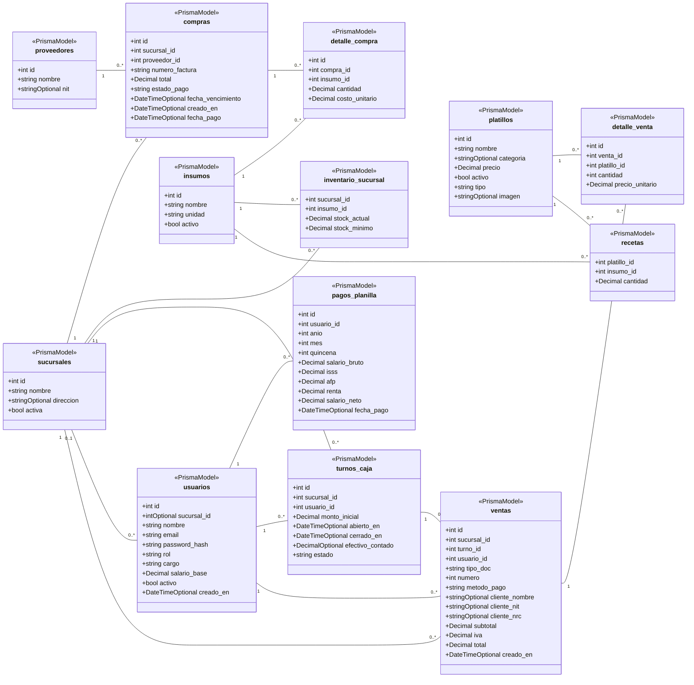

# Diagrama de clases del dominio

El diagrama representa las entidades persistidas de Orígenes SV. Los atributos muestran sus tipos y si admiten valores nulos. Las asociaciones siguen las claves foráneas de Prisma.

## Reglas relevantes

- El sufijo Optional indica un atributo que admite nulos.
- Un usuario puede carecer de sucursal. En este módulo, una cuenta ADMIN sin sede asignada corresponde a Administración central.
- Una sede inactiva conserva sus relaciones con ventas, compras y turnos.
- inventario_sucursal y recetas utilizan claves primarias compuestas.
- El correlativo de una venta es único por sucursal y tipo de documento.

El esquema Prisma conserva las claves y restricciones completas. 
