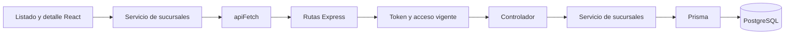

# Notas técnicas del módulo de sucursales

## Componentes y comunicación

La ruta `/admin/sucursales` presenta el listado y `/admin/sucursales/:id` presenta el detalle. Ambas requieren el rol `ADMIN` en el frontend.

`SucursalesPage` consulta el listado, aplica filtros y coordina la creación. `SucursalDetallePage` consulta una sede y coordina la edición y el cambio de estado. `SucursalForm` comparte campos y validación entre creación y edición. `SucursalEstadoConfirmacion` gestiona la confirmación y `SucursalMetricas` presenta las cifras recibidas.

Los servicios de sucursales utilizan `apiFetch`, que agrega el token y maneja errores HTTP. La variable `VITE_API_URL` del entorno actual contiene `/api`. Los servicios agregan el segmento `/sucursales`.

## Autorización

`cargarAccesoSucursales` consulta en PostgreSQL el rol, la asignación y el estado activo del usuario identificado por el token. `esAdminCentral` exige `rol === 'ADMIN'` y `sucursal_id === null`. `requireAdminCentral` protege las escrituras y el dashboard global.

El listado limita las cuentas con sede asignada a su propia sucursal. Una cuenta sin sede y con un rol diferente de `ADMIN` recibe una lista vacía. El detalle exige `ADMIN` y verifica que sea central o que consulte su sede asignada.

## Contrato HTTP

| Método y ruta | Uso |
| --- | --- |
| `GET /api/sucursales` | Sedes activas dentro del alcance de la cuenta. Lo utiliza el selector compartido. |
| `GET /api/sucursales?todas=true` | Listado administrativo, incluidas inactivas y métricas, dentro del alcance de la cuenta. |
| `GET /api/sucursales/:id` | Detalle con métricas. |
| `POST /api/sucursales` | Crea una sede activa. Recibe `nombreSucursal` y `direccionSucursal`. |
| `PATCH /api/sucursales/:id` | Actualiza los campos enviados entre `nombre`, `direccion` y `activa`. |
| `PUT /api/sucursales/:id` | Alias de actualización parcial del backend existente. |
| `DELETE /api/sucursales/:id` | Desactivación lógica del backend existente. |
| `GET /api/sucursales/dashboard/estadisticas` | Estadísticas globales de Administración central. |

El frontend usa `PATCH` tanto para editar como para cambiar el estado. `activa` debe ser booleano. La creación devuelve `201` y la actualización `200`, con la sede en `sucursal`. Los errores usan la propiedad `error`.

## Cálculo diario

El listado administrativo y el detalle incluyen `resumen` con `fecha`, `empleados_activos`, `ventas_hoy` y `transacciones_hoy`.

`rangoDiaSV` obtiene la fecha en `America/El_Salvador` y construye el intervalo desde su medianoche hasta la del siguiente día. Las consultas usan un inicio inclusivo y un fin exclusivo. El total de ventas se devuelve como texto decimal. La interfaz lo presenta en USD.

Las fechas de venta del esquema son `timestamp without time zone`. El cálculo utiliza fechas almacenadas como UTC. La base local verificada utiliza `Etc/UTC`. En otros entornos debe comprobarse esa configuración para mantener la interpretación temporal de los registros.

`obtenerSucursalPorId` conserva la consulta básica usada por caja y compras. El controlador del detalle solicita explícitamente el resumen. Los listados operativos sin `todas=true` mantienen su consulta básica.

## Datos de demostración

El seed asigna al usuario `admin@origenes.sv` el rol `ADMIN` sin sede. Los gerentes de sucursal conservan su sede asignada. Cambiar el archivo de seed requiere cargar esos datos o aplicar la actualización correspondiente a una base existente.

## Validación realizada

- Compilación del frontend satisfactoria y revisión de diferencias de Git.
- Pruebas HTTP con Prisma simulado para autenticación, permisos vigentes, alcance por sede y actualizaciones.
- Pruebas de navegador con API simulada para listado, filtros, detalle, creación, edición, cambio de estado y manejo de errores.
- Pruebas del rango diario en el cambio de medianoche de El Salvador y en fin de año.
- Comparación de consultas SQL directas con listado y detalle de la API el 10 de noviembre de 2026 en PostgreSQL local.

| Sede local | Usuarios activos asignados | Ventas del día | Transacciones |
| --- | ---: | ---: | ---: |
| Central | 7 | 0.00 | 0 |
| Escalón | 5 | 0.00 | 0 |
| Santa Tecla | 5 | 0.00 | 0 |
| Santa Elena | 0 | 0.00 | 0 |

Las tres fuentes coincidieron. La base tenía 850 ventas históricas y la última correspondía al día anterior en El Salvador. Esta comparación real cubrió un día sin ventas. Los importes positivos se verificaron con respuestas simuladas.

## Participación de IA

Codex apoyó la inspección del repositorio, la implementación, la integración del backend, el diagnóstico y las verificaciones descritas. Kenneth coordinó las decisiones con su equipo, ejecutó pruebas manuales y registró los commits de los incrementos.

Este texto resume el trabajo realizado. La entrega académica debe incorporar también los prompts y contextos originales, la bitácora, las referencias y la declaración de herramientas y dependencias del proyecto.
